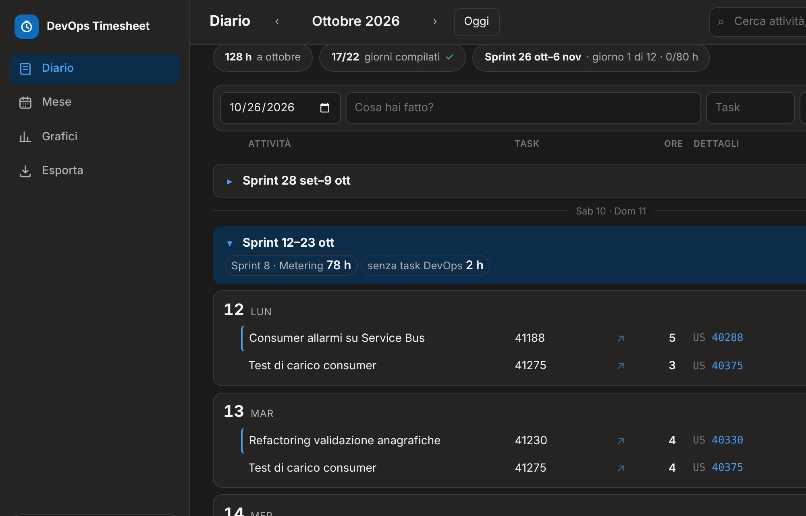

# DevOps Timesheet

Il diario ore che si compila da solo con le ore dei tuoi task di **Azure DevOps**. Ferie, malattie, permessi e attività fuori dai task li aggiungi a mano.

**Apri l'app → https://davidedg87.github.io/devops-timesheet/**



## Cosa fa

- **Legge le ore dai task.** Ricostruisce giorno per giorno quanto hai lavorato, dagli incrementi del *Completed Work* che hai registrato sui task, in uno o più progetti.
- **Carica le ore sui task.** Le ore scritte nel diario e non ancora su Azure DevOps aggiornano *Completed Work* e *Remaining Work*, con una conferma prima di scrivere.
- **Assenze a mano.** Ferie, permessi, malattia, congedi e altre causali, con il loro codice.
- **Viste.** Diario del giorno, griglia del mese, grafici e sprint presi dalle iterazioni dei progetti.
- **Export CSV** per settimana, mese o sprint, pronto per Excel.
- **Funziona anche sul telefono**, e si può installare come app.

## Come funziona

Non c'è un server. La pagina è statica e gira tutta nel tuo browser, che parla solo con due servizi:

```
                ┌──────────────────────────┐
                │  DevOps Timesheet        │
                │  (pagina nel browser)    │
                └──────┬────────────┬──────┘
   ore dei task,       │            │   attivita.json
   iterazioni          ▼            ▼   (le tue ore e assenze)
        ┌────────────────┐    ┌──────────────────────────┐
        │  Azure DevOps  │    │  il tuo repo GitHub      │
        │  (API REST)    │    │  privato                 │
        └────────────────┘    └──────────────────────────┘
```

- I tuoi dati stanno in un file `attivita.json` in un **tuo repo GitHub privato**. Lo ritrovi su ogni PC e sul telefono, e ogni salvataggio è un commit, quindi hai lo storico di tutte le versioni.
- I token restano nel browser. Il token di Azure DevOps viene salvato anche in `segreti.json` nel repo privato, così sugli altri dispositivi non devi reinserirlo.

## Configurazione (circa 5 minuti)

Al primo avvio l'app ti guida in due passi. Ecco cosa ti serve.

### Passo 1 · Repo GitHub per i dati

1. **Crea un repo privato.** Apri [github.com/new](https://github.com/new), scegli un nome (ad esempio `timesheet-data`), seleziona **Private** e premi **Create repository**. Può restare vuoto.
2. **Crea un token di accesso.** Apri [Fine-grained tokens → Generate new token](https://github.com/settings/personal-access-tokens/new) e compila così:
   - **Expiration**: fino a un anno (alla scadenza ne crei uno nuovo).
   - **Repository access**: *Only select repositories*, poi scegli il repo appena creato.
   - **Permissions → Repository permissions → Contents**: *Read and write*.

   Premi **Generate token** e copialo.
3. **Nell'app** scrivi il repo (`tuo-utente/timesheet-data`) e incolla il token. Se il repo è vuoto, scegli **Un diario vuoto**.

L'app rifiuta i repo pubblici: ore e assenze, malattie comprese, sono dati personali.

### Passo 2 · Azure DevOps (puoi farlo anche dopo)

1. Apri [dev.azure.com](https://dev.azure.com), clicca l'icona **User settings** in alto a destra (omino con l'ingranaggio) → **Personal access tokens** → **+ New Token**.
2. Compila così:
   - **Name**: `DevOps Timesheet`
   - **Organization**: *All accessible organizations*
   - **Expiration**: fino a un anno
   - **Scopes**: *Custom defined*, poi *Show all scopes* e spunta:

| Permesso | Livello | A cosa serve |
|---|---|---|
| Work Items | Read & write | leggere le ore dei task e caricare quelle scritte nel diario |
| Project and Team | Read | mostrarti l'elenco dei progetti |
| User Profile | Read | mostrarti l'elenco delle tue organizzazioni |

3. Premi **Create** e **copia il token**: Azure DevOps lo mostra una volta sola.
4. **Nell'app** incolla il token, scegli l'organizzazione e spunta i progetti da cui leggere le ore.

Se hai saltato questo passo, lo riprendi dal riquadro **Azure DevOps** in basso a sinistra o da **Impostazioni**.

## Uso quotidiano

- **Le ore dei task arrivano da sole** a ogni apertura. Puoi anche premere **Sincronizza** nel riquadro Azure DevOps.
- **Aggiungere un'attività**: usa la riga in alto nel Diario (giorno, cosa hai fatto, task, ore). Commessa e nota stanno sotto **Altro**. Sul telefono c'è il pulsante **＋**.
- **Assenze**: in ogni giorno c'è il menu **＋ Assenza**, visibile passando col mouse sulla giornata. Se non scrivi le ore, l'assenza vale una giornata intera.
- **Caricare le ore su Azure DevOps**: se ci sono ore scritte nel diario e non ancora sui task, in alto compare *"N h non ancora su DevOps · Carica"*. Prima di scrivere ti mostra il riepilogo; se qualcuno ha modificato il task nel frattempo, non sovrascrive.
- **Giorni da compilare**: i giorni lavorativi passati e vuoti sono tratteggiati in arancione, e in alto trovi quanti sono.
- **Mese, Grafici, Esporta**: dal menu a sinistra.
- **Impostazioni**: ore al giorno (8 di base, per part-time o orari diversi), tema chiaro o scuro, nome, sprint da nascondere, scorciatoie da tastiera.

### Scorciatoie da tastiera

| Tasto | Azione |
|---|---|
| `N` | nuova attività |
| `/` | cerca |
| `↑` `↓` `Invio` | muoversi tra le righe |
| `Ctrl` + `D` | duplica la riga |
| `Ctrl` + `Z` | annulla |
| `Alt` + `←` `→` | mese precedente o successivo |

## Sul telefono

1. **Installa l'app**: apri l'indirizzo con Chrome, menu ⋮ → **Installa app**.
2. **Collegala ai tuoi dati**: sul PC apri **Impostazioni → Collega un altro dispositivo** e inquadra il codice QR con il telefono. Il QR contiene l'accesso al tuo repo dei dati: mostralo solo ai tuoi dispositivi.

## Sicurezza e privacy

- **Nessun server**: i dati passano solo tra il tuo browser, il tuo repo GitHub e Azure DevOps.
- **Token di GitHub**: resta nel browser e può accedere solo al repo dei dati.
- **Token di Azure DevOps**: resta nel browser e in `segreti.json` nel repo privato. Non finisce mai in `attivita.json`, né negli export.
- **Per revocare l'accesso**: elimina i token da GitHub (*Settings → Developer settings → Personal access tokens*) e da Azure DevOps (*User settings → Personal access tokens*). L'app ti chiederà quelli nuovi.

## Problemi comuni

| Cosa succede | Cosa fare |
|---|---|
| Non compare l'elenco delle organizzazioni | Il token Azure DevOps deve valere per *All accessible organizations* e avere *User Profile: Read*. In alternativa scrivi l'organizzazione a mano: è la parola dopo `dev.azure.com/` nel tuo indirizzo. |
| "PAT non valido o scaduto" | Il token Azure DevOps è scaduto o è stato revocato: creane uno nuovo e inseriscilo da **Impostazioni → Azure DevOps**. |
| "Token GitHub non valido o scaduto" | Crea un nuovo token GitHub per il repo dei dati e ricollega l'archivio da **Impostazioni → Cambia archivio**. |
| Mancano delle ore di un task | L'app importa solo gli incrementi del *Completed Work* fatti **da te**, nei progetti scelti. Controlla che il progetto sia spuntato e premi **Sincronizza**: rilegge sempre l'ultima settimana, per le ore caricate in ritardo. |
| Non vedo la versione nuova dell'app | Ricarica la pagina con `Ctrl` + `F5`. Sul telefono chiudi e riapri l'app. |
| "I dati erano cambiati: ricaricati" | Hai salvato da un altro dispositivo: l'app ha ricaricato la versione più recente, unendo le modifiche. |

## Codici di assenza

| Codice | Causale |
|---|---|
| FER | Ferie |
| PER | Permesso retribuito (ROL) |
| PST | Permesso studio |
| MAL | Malattia |
| CPG | Congedo parentale giornaliero |
| CPO | Congedo parentale orario |
| L104 | Permesso L. 104 |
| DON | Donazione sangue |
| ASS | Assemblea / riunione sindacale |
| LUT | Permesso lutto |
| MAT | Congedo matrimoniale |
| CHI | Chiusura aziendale |
| FES | Festività / patrono |
| ALL | Permesso allattamento |

Le festività nazionali italiane, Pasquetta compresa, sono già escluse dai giorni lavorativi.

## Sviluppo

- Un solo file, `index.html`, senza build né dipendenze. Per provarlo in locale basta servirlo con un server statico qualsiasi, ad esempio `python3 -m http.server`.
- I controlli sulla logica (import da Azure DevOps, unione dei salvataggi, sprint, configurazione) si lanciano con `node checks.mjs`. Non usano la rete: le chiamate sono simulate.
- La pubblicazione è automatica: ogni push su `main` aggiorna la pagina tramite GitHub Pages.
